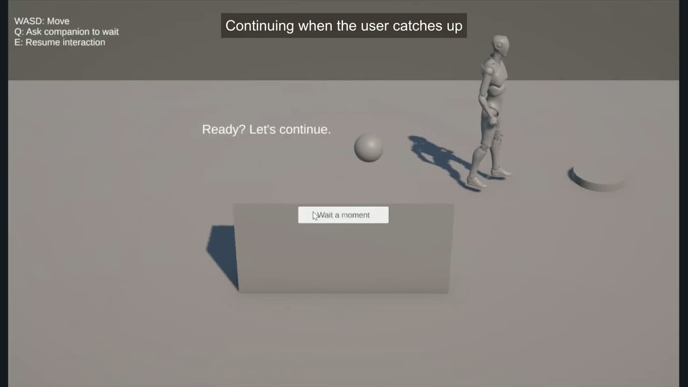
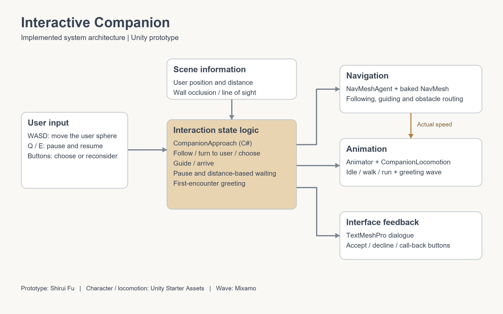

# Unity Interactive Companion

A Unity prototype in which a virtual companion greets the user, follows them around obstacles, offers to guide them to a meeting point, and waits when they fall behind. Users can pause the interaction or change their plans along the way.

**[Watch the demo on YouTube](https://youtu.be/fdqYeXeBCSE)**

## Interaction

- **Approach and greeting:** the companion checks distance and wall occlusion, turns toward the user, and waves before approaching.
- **Following:** navigation routes around the wall, with retreat behavior when the user gets too close.
- **Invitation and guiding:** accepting the invitation starts a route to the meeting point; declining keeps the companion following the user.
- **Waiting:** the companion stops and looks back beyond 3.5 m, then turns back to the route and continues when the user comes within 2.5 m.
- **Changing plans:** the call-back button stops the current activity, turns the companion toward the user, and reopens the choices.

## Controls

| Input | Action |
| --- | --- |
| WASD | Move the user sphere |
| Q | Ask the companion to wait |
| E | Resume the interaction |
| Yes, let's go / Go together | Accept the invitation or resume guiding |
| Not now / Stay with me | Choose following |
| Wait a moment | Call the companion back and reconsider |

## Implementation

| Script | Responsibility |
| --- | --- |
| [CompanionApproach.cs](Assets/CompanionApproach.cs) | Interaction states, greeting, invitations, guiding, distance-based waiting, and navigation |
| [CompanionLocomotion.cs](Assets/CompanionLocomotion.cs) | Passes navigation velocity to the Animator for standing and walking |
| [UserTargetMovement.cs](Assets/UserTargetMovement.cs) | Keyboard movement with CharacterController collision blocking |

## Run

Use **Unity 6000.6.5f1**, with URP, AI Navigation and the Input System. Package versions are recorded in `Packages/manifest.json`.

1. Clone this repository.
2. Follow [asset setup](docs/SETUP.md) to import the text resources and restore the Mixamo wave animation.
3. Open `Assets/Scenes/SampleScene.unity` and press Play.

The character model, locomotion animations, materials, textures, scene, navigation data, custom animation controller and interaction scripts are included.

## Credits

Prototype and interaction integration: **Shirui Fu**.

Character and locomotion animations: **Unity Starter Assets**. Greeting wave: **Mixamo**. Font: **Liberation Sans**. See [asset sources](THIRD_PARTY.md).
